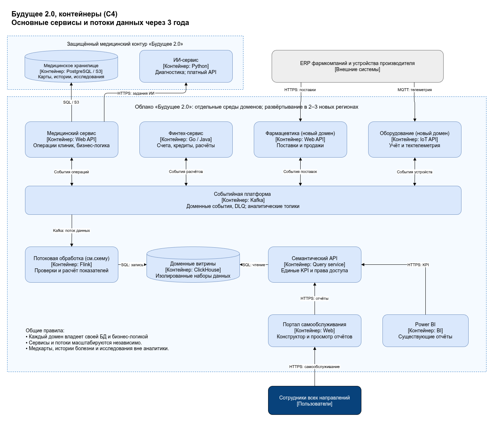
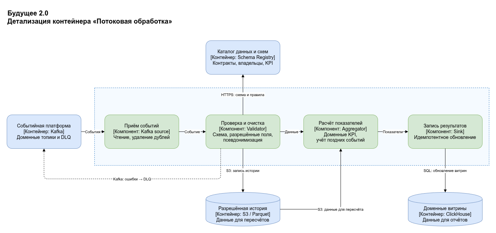

# Задание 3. Целевая архитектура и риски

- C4: контейнеры (C2) [XML](c4-containers.drawio.xml), [PNG](c4-containers.drawio.png).
- C4: компоненты потоковой обработки (C3) [XML](c4-components.drawio.xml), [PNG](c4-components.drawio.png).
- [Карта рисков и план управления](risks.md).

## Диаграммы

### Контейнеры (C2)

### Компоненты потоковой обработки (C3)

## Архитектурные решения

| Область            | Целевое состояние                                                                                                                                                                                 |
|--------------------|---------------------------------------------------------------------------------------------------------------------------------------------------------------------------------------------------|
| Домены             | Медицина, финтех, фармацевтика и оборудование владеют сервисами, БД и контрактами данных. ИИ-сервисы продаются через API; обработка клинических данных остаётся в защищённом медицинском контуре. |
| Интеграция         | Kafka, версионированные схемы, transactional outbox, идемпотентные потребители и DLQ. События заменяют междоменные синхронные цепочки.                                                            |
| Аналитика          | Потоковая обработка → доменные витрины ClickHouse → семантический API → портал самообслуживания / Power BI. S3 хранит разрешённую историю для пересчётов.                                         |
| Ограничения данных | Медкарты, истории болезни и результаты исследований не публикуются в аналитические потоки, S3 и витрины. Разрешены только согласованные операционные, финансовые и хозяйственные наборы.          |
| Масштабирование    | Независимое масштабирование сервисов; отдельные облачные проекты, сети и квоты доменов. Подключение источника через адаптер и контракт, без изменения общего DWH.                                 |
| Регионы и защита   | Региональные контуры для 2–3 новых регионов, локальное хранение чувствительных данных, OIDC, RBAC/ABAC, шифрование и аудит. Межрегионально передаются только разрешённые агрегаты.                |

## Переход и вывод легаси

| Срок          | Изменения и критерий завершения                                                                                                                                                                                        |
|---------------|------------------------------------------------------------------------------------------------------------------------------------------------------------------------------------------------------------------------|
| 0–6 месяцев   | Инвентаризация логики SQL Server 2008, контрактов и данных; пилот финансовых расчётов и пациентского потока без клинического содержимого. Внедрены схемы, outbox, DLQ, владельцы данных и сверка с исходными отчётами. |
| 6–12 месяцев  | Портал самообслуживания, разграничение доступа, первые потоковые витрины. Бизнес-пользователи работают в новой системе к концу первого года. Camel/DWH доступны через временные антикоррупционные адаптеры.            |
| 12–18 месяцев | Перенос критичных доменов и бизнес-логики из DWH в сервисы; веб-интерфейс заменяет PowerBuilder. Финтех Go/Java и ИИ Python адаптируются к контрактам; Power BI переключается на семантический API.                    |
| 18–36 месяцев | Подключение фармацевтики, оборудования и регионов. Устранение синхронных цепочек между доменами; отключение Camel, PowerBuilder и SQL Server 2008 после сверки и миграции всех потребителей.                           |

Переключение — по доменам (strangler), с одним владельцем записи и обратимым маршрутом на период стабилизации. Условие
отключения легаси: нет активных зависимостей, совпадают контрольные суммы/бизнес-итоги, пройдены SLO и восстановление,
получена приёмка владельца домена. Обязательная история сохраняется в защищённом архиве своего домена.

Отказ от DWH как центра бизнес-логики снимает узкое место; отказ от Camel и PowerBuilder устраняет
зависимость новых направлений от старого интеграционного слоя и интерфейса.
