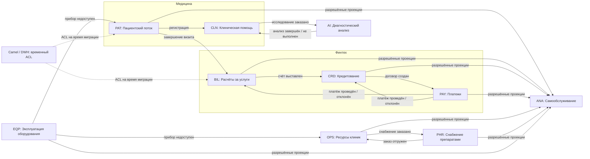

# Домены и bounded contexts

| Домен / тип                            | BC и ответственность                                                                | Владелец                            |
|----------------------------------------|-------------------------------------------------------------------------------------|-------------------------------------|
| Медицина / основной                    | **PAT: Пациентский поток**: регистрация, запись, административное завершение визита | Регистратура клиник                 |
| Медицина / основной                    | **CLN: Клиническая помощь**: медкарта, назначения, проверка заключений              | Медицинская команда                 |
| ИИ / основной                          | **AI: Диагностический анализ**: задания, версии моделей, результаты                 | Компания ИИ-сервисов                |
| Финтех / основной                      | **BIL: Расчёты за услуги**: счета, зачёт платежей                                   | Команда расчётов                    |
| Финтех / основной                      | **CRD: Кредитование**: заявки, решения, договоры                                    | Кредитная команда банка             |
| Финтех / основной                      | **PAY: Платежи**: переводы, подтверждённые расчёты                                  | Платёжная команда банка             |
| Фармацевтика / основной, будущий       | **PHR: Снабжение препаратами**: заказы клиник, резервы партий, отгрузки             | Фармацевтическая компания           |
| Оборудование / основной, будущий       | **EQP: Эксплуатация оборудования**: приборы, допуск, обслуживание                   | Производитель / сервисная команда   |
| Корпоративные сервисы / обеспечивающий | **OPS: Ресурсы клиник**: персонал, склад и приёмка снабжения                        | Головной офис / клиники             |
| Аналитика / обеспечивающий             | **ANA: Самообслуживание**: определения показателей, доступ и доменные проекции      | Платформа данных и владельцы витрин |

