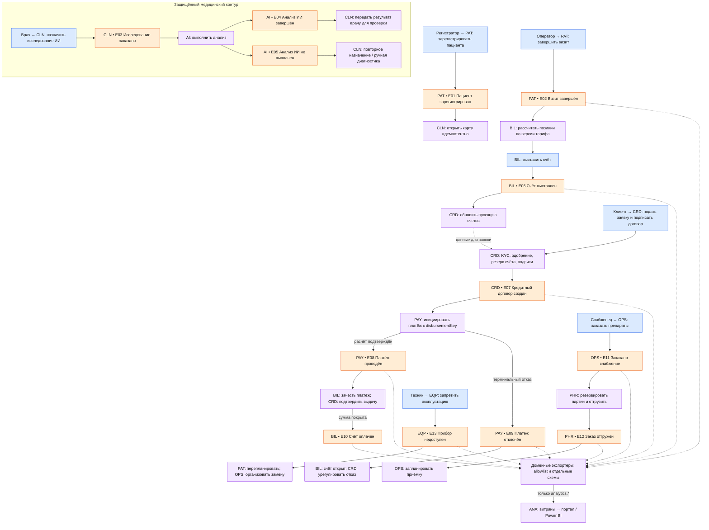

# Событийная схема

Эквивалент Event Storming:

- синий - команда,
- оранжевый - факт,
- фиолетовый - политика подписчика.

Префикс события обозначает BC-источник; ID соответствуют [каталогу](events.md). Стрелка от события ведёт к подписчику.

**Исполнение:** команда → транзакция агрегата и outbox → relay → Kafka → inbox подписчика → локальная политика/команда.
Брокер отвечает за транспорт, решения принимают BC. Ожидание результата отражается явным статусом «обрабатывается».
